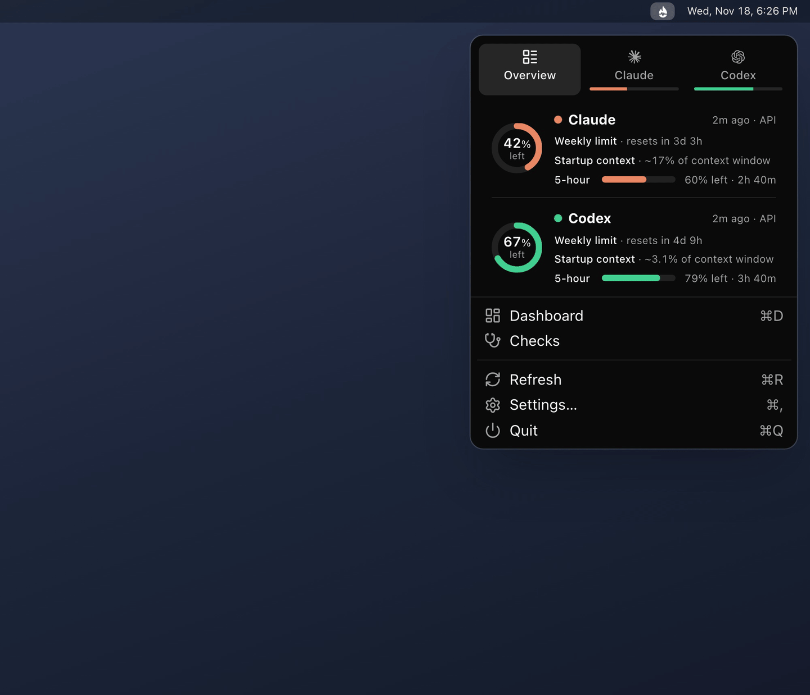

<p align="right"><a href="README.md">English</a></p>

<h1 align="center">kcal</h1>

<p align="center"><b>Claude Code, Codex, Kiro용 macOS 메뉴 막대 앱: 입력하기 전에 에이전트가 무엇을 싣는지, 사용 한도가 얼마나 남았는지 보여 줍니다.</b><br/>로컬에서만 동작합니다. 에이전트 설정은 확인을 받은 뒤에만 고칩니다.</p>

<p align="center">
  
  <br/><sub>데모 데이터입니다. kcal은 당신의 세션에서 나온 숫자를 보여 줍니다.</sub>
</p>

**제작자의 Mac에서 Claude Code는 첫 메시지 전에 37.6K 토큰을 실었습니다. Opus 5.5의 400K 창 중 9%입니다. 그중 절반쯤(19.6K)은 제작자가 직접 꾸린 설정에서 왔습니다. 스킬 52개(9.3K), 메모리 파일 9개(6.3K), MCP 서버 지침과 도구(3.6K), 커스텀 에이전트 3개(0.4K)입니다.** kcal은 당신의 설정에 대해 같은 내역을 보여 주고, 끌 만한 것을 알려 줍니다. <sub>Claude Code 2.1.322의 `/context`로 2026-11-12에 쟀습니다. 당신의 숫자는 다릅니다.</sub>

[CodexBar](https://github.com/steipete/CodexBar)는 여러 AI 코딩 제공자의 사용 한도를 보여 주고, [ccusage](https://github.com/ccusage/ccusage)는 로컬 로그에서 토큰 사용량을 읽고, Claude Code의 `/context`는 현재 세션에서 컨텍스트 창이 어떻게 쓰이는지 보여 줍니다. kcal은 Claude Code, Codex, Kiro의 남은 한도와 시작 컨텍스트를 메뉴 막대 팝오버 하나에 모아 보여 주고, 무엇을 꺼야 할지 알려 줍니다. Anthropic, OpenAI, AWS와 관련이 없습니다.

## 설치

macOS와 Claude Code가 필요합니다(Codex와 Kiro는 선택, 자세한 내용은 [요구 사항](#요구-사항)). 한 줄입니다.

```sh
curl -fsSL https://raw.githubusercontent.com/HaeDalWang/kcal/main/install.sh | sh
```

스크립트는 최신 릴리스를 받아 SHA-256을 확인하고, `kcal.app`을 `/Applications`에 설치한 뒤 실행합니다. 쓸 수 없으면 `~/Applications`에 설치합니다(sudo 없음). 다시 실행하면 업데이트됩니다. 짧으니 먼저 [`install.sh`](install.sh)를 읽어 봐도 됩니다.

**처음 30초.** kcal은 Dock 아이콘도 창도 없습니다. 처음 실행하면 메뉴 막대 아이콘 아래에 팝오버가 한 번 열리고, 그다음부터는 아이콘을 누르세요. 아이콘이 보이지 않으면 메뉴 막대가 가득 찼거나 노치에 가려진 것일 수 있으니 다른 메뉴 막대 앱을 종료해 보세요. kcal은 찾은 에이전트(Claude Code, Codex, Kiro)를 켜고, 하나도 없으면 Claude만 켭니다.

첫 한도 확인 때 kcal은 macOS Keychain에서 Claude Code 로그인 정보를 읽습니다([무엇을 보내는지](#개인정보와-읽는-것)). Claude Code가 이 항목을 kcal과 같은 `/usr/bin/security`로 저장했으므로, 시험한 Mac 한 대에서는 macOS가 묻지 않았습니다(새 Mac에서는 확인하지 못했습니다). macOS가 묻는다면 창에는 kcal이 아니라 `security`가 뜨니 허용을 누르면 됩니다. Claude Code에 로그인하지 않았다면 팝오버가 `claude`를 실행해 로그인하라고 알려 주고 Claude 한도는 보이지 않습니다. 시작 컨텍스트는 로그인이 필요 없지만, Claude Code 세션을 처음 열기 전에는 예상값뿐입니다.

**kcal은 Apple 서명과 공증이 없습니다.** Apple Developer 계정이 없어서 ad-hoc 서명만 했습니다. 뜻은 다음과 같습니다.

- 한 줄 설치는 `curl`로 받습니다. `curl`은 격리(quarantine) 표시를 붙이지 않습니다. 스크립트도 설치한 `kcal.app`에서 그 표시를 직접 지웁니다([`install.sh`](install.sh)의 `xattr -dr com.apple.quarantine` 줄). 그래서 macOS가 Gatekeeper 창을 띄우지 않습니다. 표시가 없기 때문이지 Apple이 앱을 확인해서가 아닙니다. `curl` 쪽은 2026-11-11에 한 대의 Mac에서 봤고 새 Mac에서는 확인하지 못했으며, macOS가 바꿀 수 있습니다. [결정 0020](docs/decisions/0020-unsigned-macos-release.md)(한국어)을 보세요.
- 브라우저로 [Releases](https://github.com/HaeDalWang/kcal/releases/latest)에서 `kcal-macos-universal.dmg`를 받으면 첫 실행을 macOS가 막습니다. 한 번 열어 본 뒤 **시스템 설정 → 개인정보 보호 및 보안 → 그래도 열기**를 누르세요. 스크립트로 설치한 뒤에 창이 뜨더라도 같은 방법을 쓰면 됩니다.
- SHA-256 확인은 깨진 다운로드를 잡습니다. 누가 만들었는지는 증명하지 않습니다. 그게 중요하면 [소스에서 빌드](CONTRIBUTING.md)하세요.
- 이 모두의 해결책은 유료 Apple Developer ID와 공증이고, kcal에는 그것이 없습니다.

## 무엇을 측정하나

메뉴 막대 아이콘을 누르면 에이전트별로 다음이 보입니다. 5시간·주간 한도가 얼마나 남았고 언제 초기화되는지, 시작할 때 에이전트가 토큰을 얼마나 싣는지(시스템 프롬프트, 도구, MCP 서버, 메모리 파일, 스킬), 그중 무엇을 꺼서 한도를 돌려받을 수 있는지. kcal은 로컬에서 동작하고 kcal 계정이 없습니다.

| 숫자                                              | 얻는 방법                                                                                                                                                                                                                                                                                                              |
| ------------------------------------------------- | ---------------------------------------------------------------------------------------------------------------------------------------------------------------------------------------------------------------------------------------------------------------------------------------------------------------------- |
| 남은 한도(5시간, 주간, 월간)와 초기화 시각        | **측정.** 각 제공자의 사용량 endpoint에서 읽습니다. 요청이 실패하면 로컬 로그로 대신합니다.                                                                                                                                                                                                                            |
| 시작 컨텍스트(Claude Code)                        | **측정.** 시스템 프롬프트, 내장 도구, MCP 도구 정의를 Claude Code가 실제로 보낸 요청에서 가져옵니다(바이트 ÷ 4 ≈ 토큰). Claude Code 2.1.300 이상과, 이 Mac의 Claude Code 세션이 한 번 이상 있어야 합니다. 첫 세션 전이거나 최근 세션이 크기를 보고하지 않았으면 파일만 세고 합계에 "estimate only"(예상만)를 붙입니다. |
| 지침 파일, 규칙, 스킬, 에이전트 정의              | **추정.** 파일 크기 ÷ 4. 훅은 크기를 재지 않고 개수만 셉니다.                                                                                                                                                                                                                                                          |
| 창당 요청 수, 캐시 적중률                         | 세션 로그에서 **측정.**                                                                                                                                                                                                                                                                                                |
| 한도 1%당 토큰 수, 설정 하나가 차지하는 한도 비중 | 로그에서 **추정**하고 `~`를 붙여 보여 줍니다. 기록이 충분해질 때까지는 "아직 기록이 없어요" 또는 "기록 모으는 중"으로 표시합니다.                                                                                                                                                                                      |
| 질문당 Kiro 크레딧                                | Kiro 세션 로그에서 **측정.**                                                                                                                                                                                                                                                                                           |

팝오버는 추정값에 `~`를 붙이고 가리키면(hover) 어떻게 측정했는지 보여 줍니다. 데이터가 없으면 없다고 표시하고, 리셋 시각이 지나면 다음 확인 전까지 그 구간을 리셋된 것으로 표시합니다.

읽기 말고도 kcal은 **점검 → 진단**에서 Claude·Codex·Kiro 플러그인과 Codex·Kiro MCP 서버를 대신 꺼 줄 수 있습니다. Claude Code의 MCP 서버는 `/mcp`에서 끄는 방법만 알려 줍니다(Claude가 실행 중에 `~/.claude.json`을 다시 쓰기 때문입니다). 규칙 파일 머리말에 `paths:`를 넣어 맞는 파일을 다룰 때만 싣게 하거나 규칙을 스킬로 옮길 수도 있습니다. 바꿀 정확한 줄을 보여 주고, 원본 옆에 백업(`<이름>.kcal-<UTC 시각>.bak`)을 만들고, 되돌리기 버튼을 둡니다. 되돌리기는 kcal이 바꾼 뒤 파일이 그대로일 때만 됩니다. 그 뒤에 사용자나 에이전트가 파일을 고쳤으면 다른 줄이라도 되돌리지 않고, 백업을 직접 되살리는 `cp` 명령을 보여 줍니다. 확인하기 전에는 아무것도 바꾸지 않습니다.(`src-tauri/src/coach/switches.rs`, `scope.rs`, `checks/rules_apply.rs`)

진단은 최근 30일 Claude Code 기록(세션 10개 이상)에서 한 번도 안 쓴 것만 끄라고 제안합니다. 기록이 그보다 적으면 알 수 없다고 말하고 제안하지 않습니다. Codex·Kiro 플러그인과 MCP 서버는 얼마나 쓰는지 kcal이 볼 수 없어서 끄라고 제안하지 않습니다(직접 끌 수는 있습니다). 1~3개 프로젝트에서만 쓴 플러그인에는, 그 30일 동안 3번 이상 썼을 때만(세션 10개 조건 포함) "프로젝트에서만 켜기"를 보여 줍니다. 각 줄에는 쓴 횟수, 센 세션 수, 마지막으로 쓴 날짜와 프로젝트가 나오며, 모두 kcal이 Claude 세션 기록에서 센 값입니다. 30일, 10세션, 3번은 설정입니다.

## 개인정보와 읽는 것

텔레메트리, 분석, 자동 업데이트, kcal 서버가 없습니다. 이 표는 kcal이 읽고, 보내고, 쓰는 것 전부입니다. 각 행은 소스에서 도출했고, 파일과 함수는 마지막 열에 있습니다(줄 번호는 금방 어긋나서 함수 이름을 씁니다).

| 무엇                                                                                                                                                                                                                                                                         | 왜                                                                                                 | 어디로 가나                                                                                                                                                                                                                                                                                                                                                                                                                                                                                                                                                                                           | 소스                                                                                                                                                                           |
| ---------------------------------------------------------------------------------------------------------------------------------------------------------------------------------------------------------------------------------------------------------------------------- | -------------------------------------------------------------------------------------------------- | ----------------------------------------------------------------------------------------------------------------------------------------------------------------------------------------------------------------------------------------------------------------------------------------------------------------------------------------------------------------------------------------------------------------------------------------------------------------------------------------------------------------------------------------------------------------------------------------------------- | ------------------------------------------------------------------------------------------------------------------------------------------------------------------------------ |
| macOS Keychain 항목 `Claude Code-credentials`(`/usr/bin/security find-generic-password`로 읽음)                                                                                                                                                                              | 한도를 물으려고 Claude Code 액세스 토큰을 얻음                                                     | 토큰은 확인할 때마다 한 번, bearer 헤더로 `https://api.anthropic.com/api/oauth/usage`에 보냅니다. 저장하지 않고, 로그에 남기지 않고, 갱신하지 않습니다. macOS가 묻는지는 상황에 따라 다릅니다(처음 30초 참고).                                                                                                                                                                                                                                                                                                                                                                                        | `src-tauri/src/usage/sources.rs`: `claude_credentials`, `read_keychain`, `claude`                                                                                              |
| `~/.codex/auth.json`(액세스 토큰, 계정 id). Codex를 켠 경우만                                                                                                                                                                                                                | 같은 이유, Codex용                                                                                 | `https://chatgpt.com/backend-api/wham/usage`로 보냅니다.                                                                                                                                                                                                                                                                                                                                                                                                                                                                                                                                              | `usage/sources.rs`: `codex_tokens`, `codex`                                                                                                                                    |
| `kiro-cli chat --v2 --no-interactive /usage`. Kiro를 켠 경우만                                                                                                                                                                                                               | Kiro 크레딧을 얻음                                                                                 | kcal이 당신의 `kiro-cli`를 실행해 출력을 읽습니다. kcal이 Kiro 네트워크를 직접 부르지는 않습니다. `kiro-cli`가 평소 하던 일을 합니다.                                                                                                                                                                                                                                                                                                                                                                                                                                                                 | `usage/sources.rs`: `kiro`                                                                                                                                                     |
| `~/.local/share/agent-usage-audit/data/claude-ratelimits.jsonl`, 파일이 있을 때만(Claude Code가 아닌 별도 개인 도구가 만든 파일)                                                                                                                                             | Keychain을 읽지 못하거나 사용량 요청이 실패할 때 Claude 한도                                       | 당신의 Mac을 떠나지 않습니다. 마지막 rate limit 줄을 읽습니다.                                                                                                                                                                                                                                                                                                                                                                                                                                                                                                                                        | `usage/paths.rs`: `claude_statusline_log`; `usage/sources.rs`: `with_log_fallback`                                                                                             |
| 세션 로그: `~/.claude/projects`, `~/.codex/sessions`, `~/.kiro/sessions`                                                                                                                                                                                                     | 시작 컨텍스트, 창당 요청 수, 캐시 적중률, 그리고 Claude는 플러그인·MCP 서버별 최근 사용 횟수(진단) | 당신의 Mac을 떠나지 않습니다. 필요한 종류의 줄만 파싱하고, 플러그인·서버 이름, 횟수, 세션을 시작한 폴더(폴더 이름으로 표시)만 남기며 메시지 본문은 저장하거나 보여 주지 않습니다. 점검 탭을 열면 진단이 최근 30일 Claude 기록을 최신 순으로 최대 1000개 파일·2 GiB까지 읽습니다. 두 한도는 설정입니다. (Codex·Kiro 파서는 줄 단위로 확인하지 않았으니 제가 읽은 바입니다.)                                                                                                                                                                                                                            | `context/shape.rs`: `jsonl_files`; `context/codex_session.rs`: `rollout_files`; `context/kiro_session.rs`: `message_files`; `metrics/claude.rs`: `log_files`; `coach/usage.rs` |
| 에이전트 설정: `~/.claude/`(설정, `CLAUDE.md`, 규칙, 스킬), `~/.claude.json`, `~/.codex/`(`config.toml` 포함), `~/.kiro/`                                                                                                                                                    | 시작 컨텍스트 크기를 잼                                                                            | 당신의 Mac을 떠나지 않습니다. 크기와 머리말을 보려고 읽고 바로 버립니다.                                                                                                                                                                                                                                                                                                                                                                                                                                                                                                                              | `context/paths.rs`: `claude_root`, `claude_state_file`, `codex_root`, `kiro_root`; `context/instructions.rs`: `codex_doc_settings`                                             |
| 작업한 프로젝트 폴더(세션의 `cwd`): 프로젝트 폴더와 `/`까지 모든 상위 폴더의 `CLAUDE.md`·`AGENTS.md`, 그 `CLAUDE.md`가 `@import`하는 파일(경로가 `~/...` 등 어디든 가리킬 수 있음), `<프로젝트>/.claude/settings.json`·`settings.local.json`, `.mcp.json`, `.codex`, `.kiro` | 프로젝트 단위 규칙과 MCP 서버 크기를 잼                                                            | 당신의 Mac을 떠나지 않습니다. 크기와 머리말을 보려고 읽고 바로 버립니다.                                                                                                                                                                                                                                                                                                                                                                                                                                                                                                                              | `context/instructions.rs`: `lineage`, `resolve_import`; `context/scan.rs`: `claude_mcp_servers`, `claude_settings`, `codex`                                                    |
| **Claude 넘기기 버튼**(누를 때만): 당신의 `claude -p --safe-mode --tools ""`를 실행                                                                                                                                                                                          | Claude에게 너무 긴 지침 파일 하나를 줄이게 함                                                      | 그 파일 하나의 텍스트가 당신의 Claude Code를 거쳐 Anthropic으로 가고, 당신의 한도를 씁니다. 모델은 Opus 5.5로 고정입니다. **이대로 바꾸기**를 누르기 전에는 아무것도 쓰지 않습니다.                                                                                                                                                                                                                                                                                                                                                                                                                   | `coach/checks/handoff.rs`: `MODEL`, `args`; [결정 0018](docs/decisions/0018-claude-handoff.md)(한국어)                                                                         |
| kcal이 쓰는 것                                                                                                                                                                                                                                                               | 설정, 한도 기록, 적용 로그                                                                         | `~/Library/Application Support/io.github.haedalwang.kcal/`(`settings.json`, `settings.seen`: 첫 실행 팝오버를 다시 열지 않게 하는 빈 파일, `limit-history.jsonl`: 시각과 퍼센트만 있고 토큰은 없음, `coach-log.jsonl`, `check-dismissed.json`: 숨긴 카드 id, `claude-handoff/`: 넘기기 버튼용 파일), 위에서 말한 `.bak` 백업, 그리고 확인한 설정 수정: 사용자 `~/.claude/settings.json`, `~/.codex/config.toml`, `~/.kiro/settings/mcp.json`, 규칙·스킬 파일, "이 프로젝트에서만 켜기"일 때는 `<프로젝트>/.claude/settings.local.json`(없으면 만들고, 플러그인을 쓴 폴더에만). 되돌리기로 되돌립니다. | `settings.rs`: `from_app`; `coach/switches.rs`, `coach/scope.rs`; [결정 0006](docs/decisions/0006-exchange-rate.md), [0014](docs/decisions/0014-coaching.md)(모두 한국어)      |

네트워크 요약: 앱은 실행 중에 기본으로 5분마다 `api.anthropic.com`에 접속합니다(Codex를 켜면 `chatgpt.com`도, Kiro는 `kiro-cli`를 통해 10분마다. 두 간격 모두 설정입니다). rate limit 응답을 받으면 간격이 두 배로 늘어 기본 최대 60분까지 가고, 새로고침을 누르면 그때도 확인합니다. 켠 에이전트만 조회합니다(`usage/schedule.rs`: `plan`). Rust와 프론트엔드 소스에서 다른 URL, HTTP 클라이언트, 플러그인을 찾아봤고, 테스트 데이터와 UI가 글자로만 보여 주는 문서 링크 말고는 없었습니다. 웹뷰의 Content Security Policy는 로컬 IPC만 허용합니다(`src-tauri/tauri.conf.json`의 `app.security.csp`). 직접 확인해 보세요: `git grep -nE 'https?://' -- src src-tauri/src`.

## 요구 사항

- macOS. 범용 바이너리(arm64와 x86_64)로 빌드합니다. 개발과 실행은 Apple Silicon의 macOS 27에서만 했고, Intel Mac에서는 실행해 보지 않았습니다. 앱이 선언한 최소 버전은 macOS 10.13(Tauri 기본값)입니다. 개발용 Mac보다 오래된 버전은 시험하지 않았습니다.
- [Claude Code](https://code.claude.com)를 Claude Pro 또는 Max 계정으로 로그인해야 합니다(한도는 구독 요금제에만 있습니다). API 키, Bedrock, Vertex를 쓰면 시작 컨텍스트는 보이지만 한도는 보이지 않습니다.
- Codex CLI와 Kiro CLI는 선택입니다. kcal은 설정에서 켠 에이전트만 보여 주고, 처음 실행할 때 찾은 에이전트를 켭니다.
- Windows: 아직 없습니다. CI에서 빌드와 테스트는 통과하지만 앱을 macOS에서만 실행해 봤고 설치 파일도 없습니다.

## FAQ

**서명 없는 앱을 실행해도 안전한가요?**
읽을 수 있는 소스만큼 안전합니다. 이 저장소를 GitHub의 [`release.yml`](.github/workflows/release.yml)이 빌드합니다. 서명이 없다는 것은 Apple이 검증하지 않았고, 인증서로 제작자를 증명할 수 없다는 뜻입니다. 믿고 싶지 않다면 개인정보 표를 읽고, 소스를 grep하고, 직접 빌드하세요.

**데이터를 어딘가로 보내나요?**
kcal은 세션, 프롬프트, 설정 내용을 올리지 않습니다. 네트워크 호출은 위의 사용량 endpoint와, 누른 경우의 Claude 넘기기 버튼뿐입니다. 표를 보세요.

**왜 토큰이 필요한가요?**
남은 한도는 Claude Code가 쓰는 것과 같은 사용량 endpoint 뒤에 있고, 그 endpoint는 당신의 로그인을 요구합니다. kcal은 Keychain에서 토큰을 읽어 그 요청 한 번에만 쓰고, 갱신하지도 저장하지도 않습니다. Keychain을 읽지 못하거나 사용량 요청이 실패하면(예: Keychain 창에서 거부) kcal은 Claude 한도를 보여 주지 않습니다.

**시작 숫자는 정확한가요?**
항상은 아닙니다. 시스템 프롬프트, 내장 도구, MCP 도구 정의는 Claude Code가 보낸 요청에서 측정합니다(Claude Code 2.1.300 이상). 지침 파일, 규칙, 스킬, 에이전트 정의는 파일 크기라서 합계에는 추정이 섞입니다. 토큰은 바이트 ÷ 4이고 실제 토크나이저가 아닙니다. 시작 항목 중 하나라도 추정이면 합계 앞에 `~`를 붙이고, 툴팁이 어떤 종류인지 알려 줍니다.

**Codex나 Kiro 없이도 되나요?**
됩니다. Claude Code만 있어도 충분합니다. 다른 탭은 켠 에이전트에만 나타납니다.

**로그인할 때 자동으로 켜지나요?**
스스로는 안 켜집니다. **시스템 설정 → 일반 → 로그인 항목**(macOS 버전마다 이름이 조금 다릅니다)의 "로그인 시 열기"에서 +를 눌러 kcal.app을 넣으세요.

**얼마나 무거운가요?**
Electron이 아니라 Tauri 앱입니다(Rust + 시스템 WebKit). 만든 사람의 Apple M5 Mac에서 릴리스 빌드를 에이전트 설정 없이 5분 그대로 두었을 때(한 번 측정) 메인 프로세스의 CPU 시간은 0.02초였고, 메모리 footprint는 24MB에 팝오버를 그리는 WebKit 프로세스 약 40MB를 더한 값이었습니다(그 프로세스들의 CPU 시간은 0.02초에 들어 있지 않습니다). 활동 상태 보기의 RSS는 공유 페이지까지 세서 메인 프로세스만 약 91MB로 보였습니다. 에이전트가 설정되어 있으면 타이머로 한도도 조회하는데, 그 경우는 아직 재지 않았습니다.

**Windows와 Linux는요?**
Windows: 아직 없습니다. 위를 보세요. Linux: 지원하지 않습니다.

**어떻게 삭제하나요?**

```sh
rm -rf /Applications/kcal.app "$HOME/Applications/kcal.app" \
  "$HOME/Library/Application Support/io.github.haedalwang.kcal" \
  "$HOME/Library/WebKit/io.github.haedalwang.kcal" \
  "$HOME/Library/Caches/io.github.haedalwang.kcal" \
  "$HOME/Library/Caches/kcal" "$HOME/Library/WebKit/kcal"
```

이 명령은 kcal이 에이전트 설정 옆에 만든 `*.kcal-<시각>.bak` 백업과 kcal이 만든 스킬은 지우지 않습니다. 그 변경(kcal이 만든 `<프로젝트>/.claude/settings.local.json` 포함)도 되돌리려면 먼저 kcal에서 되돌리기(Undo)를 누르세요.

## 기여

개발 환경, 명령, 프로젝트 구조, 설계 결정은 [CONTRIBUTING.md](CONTRIBUTING.md)에 있습니다. 결정 기록은 [`docs/decisions/`](docs/decisions/)(한국어)에 있습니다.

## 라이선스

[MIT](LICENSE)

---

도움이 됐다면 스타를 눌러 주세요. 다른 사람이 찾는 데 도움이 됩니다.
