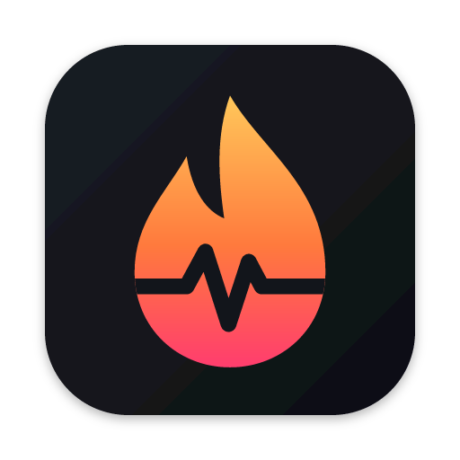
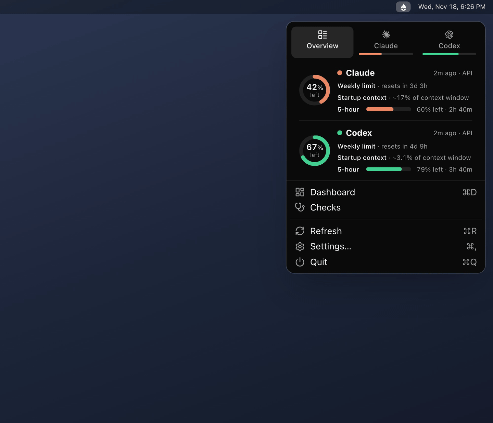

<p align="right"><a href="README.ko.md">한국어</a></p>

<p align="center"></p>

<h1 align="center">kcal</h1>

<p align="center"><b>A macOS menu bar app for Claude Code, Codex and Kiro: see what your agent loads before you type, and how much usage limit is left.</b><br/>Local only. Changes your agent config only after you confirm, with a backup and Undo.</p>

<p align="center">
  
  <br/><sub>Demo data. kcal shows numbers from your own sessions.</sub>
</p>

**In the author's setup, Claude Code loaded 37.6K tokens before the first message: 9% of Opus 5.5's 400K-token context window. About half of that (19.6K) came from what the author added: 52 skills (9.3K), 9 memory files (6.3K), MCP server instructions and tools (3.6K), 3 custom agents (0.4K).** kcal shows the same split for your setup and points at what you could switch off. <sub>Measured with `/context` in Claude Code 2.1.322 on 2026-11-12. Your numbers will differ.</sub>

[CodexBar](https://github.com/steipete/CodexBar) shows usage limits for many AI coding providers, [ccusage](https://github.com/ccusage/ccusage) reads token usage from local logs, and Claude Code's `/context` shows how the context window is used in the current session. kcal puts the limit left and the startup context for Claude Code, Codex and Kiro in one menu bar popover, and suggests what to switch off. Not affiliated with Anthropic, OpenAI or AWS.

## Install

You need macOS and Claude Code. With a Claude Pro or Max login you see your limit left and the startup context; with an API key, Bedrock or Vertex you see the startup context only. Codex and Kiro are optional. Details and what I have not tested: [Requirements](#requirements). One line:

```sh
curl -fsSL https://raw.githubusercontent.com/HaeDalWang/kcal/main/install.sh | sh
```

The script downloads the latest release, checks its SHA-256, installs `kcal.app` to `/Applications` (or `~/Applications` if that isn't writable, no sudo), and opens it. Run it again to update. Read [`install.sh`](install.sh) first if you like; it is short.

**What you will see.** kcal has no Dock icon and no window. The first launch opens the popover once under its menu bar icon; after that, click the icon. If you don't see it, your menu bar may be full or behind the notch: quit another menu bar app. kcal turns on the agents it finds (Claude Code, Codex, Kiro); if it finds none, it turns on Claude only. It only reads until you confirm a change.

<details>
<summary>Keychain prompt, sign-in, and why the app is unsigned</summary>

**Keychain and sign-in.** The first limit check reads your Claude Code login from the macOS Keychain ([what is sent](#privacy-and-what-it-reads)). If macOS asks, the prompt names `security`, not kcal: click Allow. Whether it asks on a clean Mac is listed under [Not yet tested](#not-yet-tested). If you aren't signed in to Claude Code, the popover tells you to run `claude` and sign in, and shows no Claude limit. Startup context doesn't need the sign-in, but before your first Claude Code session it is an estimate only.

**kcal is not signed or notarized by Apple.** There is no Apple Developer account behind it, so the app is ad-hoc signed only (signed without a developer certificate). What that means:

- The one-line install downloads with `curl`, which does not set the quarantine flag. The script also removes that flag from `kcal.app` itself (the `xattr -dr com.apple.quarantine` line in [`install.sh`](install.sh)). That is why macOS shows no Gatekeeper prompt: no flag is set, not because Apple checked the app. macOS may change the `curl` behavior; see [Not yet tested](#not-yet-tested) and [decision 0020](docs/decisions/0020-unsigned-macos-release.md) (English summary at the top).
- If you download `kcal-macos-universal.dmg` from [Releases](https://github.com/HaeDalWang/kcal/releases/latest) in a browser, macOS blocks the first launch. Try to open it once, then go to **System Settings → Privacy & Security → Open Anyway**. Use the same step if a prompt ever appears after the script install.
- The SHA-256 check catches corrupted downloads. It does not prove who built the file. If that matters to you, [build from source](CONTRIBUTING.md).
- The fix for all of this is a paid Apple Developer ID and notarization, which kcal does not have.

</details>

## What it measures

Click the menu bar icon and you see, per agent: how much of your 5-hour and weekly limit is left and when it resets, how many tokens the agent loads at startup (system prompt, tools, MCP servers, memory files, skills), and which of those you could turn off to get limit back. kcal runs locally and has no kcal account. In short:

- Limit left and reset time come from each provider's usage endpoint, with local logs as a fallback.
- Claude Code's startup context is measured from the request it actually sent; instruction files, rules and skills are estimated from file size.
- Estimated values are marked `~`.

| Number                                                         | How it is obtained                                                                                                                                                                                                                                                                                                                                                 |
| -------------------------------------------------------------- | ------------------------------------------------------------------------------------------------------------------------------------------------------------------------------------------------------------------------------------------------------------------------------------------------------------------------------------------------------------------ |
| Limit left (5-hour, weekly, monthly) and reset time            | **Measured.** Read from each provider's usage endpoint; falls back to local logs when that request fails.                                                                                                                                                                                                                                                          |
| Startup context (Claude Code)                                  | **Measured.** System prompt, built-in tools and MCP tool definitions, taken from the request Claude Code actually sent (bytes ÷ 4 ≈ tokens). Needs Claude Code 2.1.300 or newer and at least one Claude Code session on this Mac. Before the first session, or if no recent session reported the size, kcal counts only files and marks the total "estimate only". |
| Instruction files, rules, skills, agent definitions            | **Estimated.** File size ÷ 4. Hooks are counted, not sized.                                                                                                                                                                                                                                                                                                        |
| Requests per window, cache hit rate                            | **Measured** from your session logs.                                                                                                                                                                                                                                                                                                                               |
| Tokens per 1% of the limit, share of the limit a setting costs | **Estimated** from your logs, shown with a `~`. Shows "No history yet" or "Collecting data" until there is enough history.                                                                                                                                                                                                                                         |
| Kiro credits per question                                      | **Measured** from Kiro session logs.                                                                                                                                                                                                                                                                                                                               |

The popover marks estimated values with `~` and lets you hover one to see how it was measured. When data is missing, kcal says so, and once a reset time passes it shows the window as reset until the next check.

Beyond reading, kcal can switch off a Claude, Codex or Kiro plugin, or a Codex or Kiro MCP server, for you under **Checks → Diagnose**. For Claude Code MCP servers it only shows how to turn them off in `/mcp`, because Claude rewrites `~/.claude.json` while running. It can also add a `paths:` line to a rule file's front matter, so the rule loads only for matching files, or move a rule into a skill. It shows the exact line it will change, backs the file up next to the original (`<name>.kcal-<UTC time>.bak`), and has an Undo button. Undo works only while the file is as kcal left it: if you or your agent edited it afterwards, even on another line, kcal refuses and shows the `cp` command to restore the backup yourself. It changes nothing until you confirm. (`src-tauri/src/coach/switches.rs`, `scope.rs`, `checks/rules_apply.rs`)

Diagnose suggests turning something off only when your last 30 days of Claude Code history, at least 10 sessions, show it was never used. With less history it says it can't tell and suggests nothing. kcal can't see how often you use a Codex or Kiro plugin or MCP server, so it never suggests turning those off; you can still turn them off yourself. Plugins used in 1–3 projects get a "Turn on only where used" option, but only after at least 3 uses in those 30 days (and the 10 sessions). Each row shows the count, the sessions it was counted from, and when and where it was last used, all counted by kcal from your Claude session logs. The 30 days, 10 sessions and 3 uses are settings.

## Privacy and what it reads

There is no telemetry, no analytics, no updater, and no kcal server. In short:

- Your Claude Code login token goes only to `api.anthropic.com` (Codex: `chatgpt.com`, only if enabled), to ask for your limit. It is not stored or refreshed. By default this check runs every 5 minutes while the app is running.
- Session logs, agent config and project files are read on your Mac; kcal keeps sizes, names and counts, not message text.
- The one other upload is the Claude handoff button, only when you press it: one instruction file goes to Anthropic through your own Claude Code.
- kcal writes its own settings folder and, only when you confirm, config edits with `.bak` backups and Undo.

The full table of what kcal reads, sends and writes, with the source file and function for each row, the network schedule, and a grep to check it yourself: [docs/privacy.md](docs/privacy.md).

## Requirements

- macOS. Built as a universal binary (arm64 and x86_64). The app's declared minimum is macOS 10.13 (Tauri's default).
- [Claude Code](https://code.claude.com) signed in with a Claude Pro or Max account (limits exist only for subscription plans). With an API key, Bedrock or Vertex you still get startup context, but no limit.
- Codex CLI and Kiro CLI are optional. kcal shows only the agents you enable in Settings, and enables the ones it finds on first run.
- Windows: not yet. It builds and passes tests on CI, and a build has run on one Windows 11 PC (tray, tooltip, popover), but there is no released installer and install and light mode are untested.

### Not yet tested

- Hardware and macOS: I developed and ran it on macOS 27 on Apple Silicon only. I have not run it on an Intel Mac, and I have not tested anything older than the dev Mac, including the declared minimum.
- Keychain prompt: on the one Mac I tried, macOS did not ask, because Claude Code stored the login item with the same `/usr/bin/security` tool kcal uses. I have not confirmed this on a clean Mac.
- Gatekeeper: I saw on one Mac on 2026-11-11 that `curl` does not set the quarantine flag. I have not confirmed it on a clean Mac, and macOS may change it.

## FAQ

**Is it safe to run an unsigned app?**
It is as safe as the source you can read: this repository, built by [`release.yml`](.github/workflows/release.yml) on GitHub. Unsigned means Apple has not vetted it and I can't prove authorship with a certificate. If you'd rather not trust that, read the [privacy table](docs/privacy.md), grep the source, or build it yourself.

**Does it send my data anywhere?**
Your sessions, prompts and config contents are not uploaded by kcal. The only network calls are the usage endpoints, and the Claude handoff button if you press it. See [the privacy table](docs/privacy.md).

**Why does it need my token?**
Your limit left lives behind the same usage endpoint Claude Code uses, and that endpoint needs your login. kcal reads the token from the Keychain, uses it for that one request, and never refreshes or saves it. If the Keychain read or the usage request fails (for example you deny the Keychain prompt), kcal shows no limit for Claude.

**Is the startup number exact?**
Not always. System prompt, built-in tools and MCP tool definitions are measured from the request Claude Code sent (Claude Code 2.1.300 or newer). Instruction files, rules, skills and agent definitions are file size, so the total is partly an estimate. Tokens are bytes ÷ 4, not a real tokenizer. kcal puts `~` in front of the total when any startup item is estimated, and the tooltip says which kind it is.

**Does it work without Codex or Kiro?**
Yes. Claude Code alone is enough. The other tabs only appear for agents you enable.

**How heavy is it?**
It's a Tauri app (Rust + the system WebKit), not Electron. One run, release build, no agents set up, idle for 5 minutes on an Apple M5 Mac: the main process used 0.02 s of CPU time; its memory footprint was 24 MB, plus about 40 MB for the WebKit processes that draw the popover (their CPU time is not in the 0.02 s). Activity Monitor's RSS counts shared pages and showed about 91 MB for the main process alone. With agents set up it also checks your limits on a timer; that case is not measured yet.

**Does it start at login?**
Not by itself. Add it in **System Settings → General → Login Items** (the name varies a little by macOS version): under "Open at Login", press + and pick kcal.app.

**What about Windows and Linux?**
Windows: not yet, see above. Linux: not supported.

**How do I uninstall?**

```sh
rm -rf /Applications/kcal.app "$HOME/Applications/kcal.app" \
  "$HOME/Library/Application Support/io.github.haedalwang.kcal" \
  "$HOME/Library/WebKit/io.github.haedalwang.kcal" \
  "$HOME/Library/Caches/io.github.haedalwang.kcal" \
  "$HOME/Library/Caches/kcal" "$HOME/Library/WebKit/kcal"
```

This does not remove the `*.kcal-<time>.bak` backups kcal made next to your agent config, or skills it created. Use Undo in kcal first if you want those changes reverted, including a `<project>/.claude/settings.local.json` kcal created.

## Contributing

Dev setup, commands, project layout and design decisions are in [CONTRIBUTING.md](CONTRIBUTING.md). Decision records are in [`docs/decisions/`](docs/decisions/) (Korean).

## License

[MIT](LICENSE)

Claude, OpenAI Codex and Kiro names and marks belong to Anthropic, OpenAI and Amazon. kcal shows them only to label whose usage you are looking at and is not affiliated with them. The mark outlines come from [CodexBar](https://github.com/steipete/CodexBar) (MIT).
